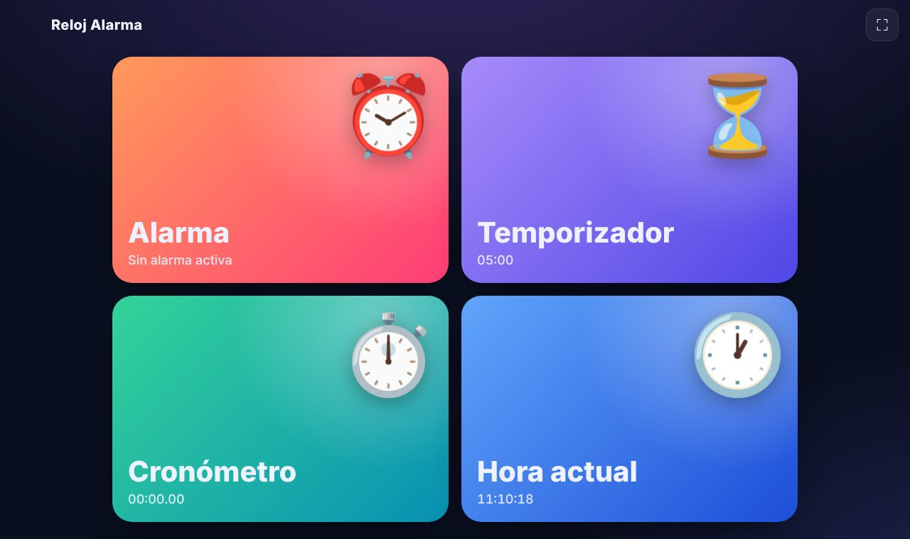
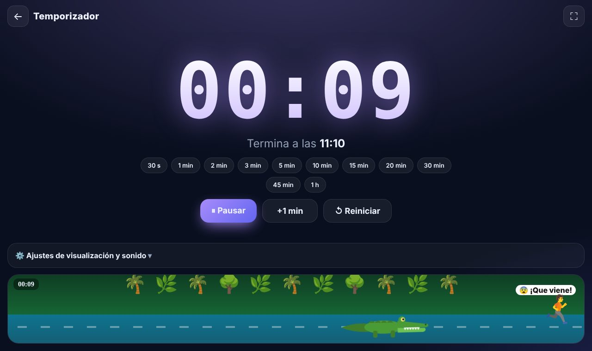

# ⏰ Reloj Alarma

App web de un solo archivo HTML para el aula y el panel interactivo: **alarma, temporizador, cronómetro y hora actual**, con pantalla completa y barras de progreso animadas.

**▶ Pruébala:** https://luisjsolsona.github.io/reloj-alarma/

## Funciones

| Herramienta | Qué hace |
|---|---|
| ⏰ Alarma | Hora, etiqueta, posponer 5 min y 5 sonidos a elegir |
| ⏳ Temporizador | Botones rápidos de 30 s a 1 h, +1 min, pausa y repetir |
| ⏱️ Cronómetro | Vueltas y tiempo objetivo para la barra |
| 🕐 Hora actual | Formato 12/24 h; la barra muestra el progreso del día, la hora, el minuto o la jornada lectiva |

Todas las pantallas tienen botón de **pantalla completa** (⛶).

## Barras de progreso

Cada herramienta guarda su propio tipo de barra (⚙️ Ajustes):

- ▬ Normal y ⭕ Circular (llenar o vaciar)
- 🏃 Carrera: el corredor llega a la meta
- 🐊 Jungla: el cocodrilo se acerca a la persona hasta el «¡ÑAM!»
- 🚀 Cohete: de la Tierra a la Luna
- 🐛 Oruga: se come las frutas y se convierte en mariposa
- 🕯️ Vela: se consume hasta apagarse
- ⏳ Reloj de arena

## Atajos

- **F**: pantalla completa
- **Espacio**: iniciar/pausar (o parar la alarma)
- **L**: vuelta en el cronómetro

## Notas

- Sin instalación ni servidor: abre `index.html` en cualquier navegador.
- La alarma y el temporizador suenan mientras la página esté abierta.
- Los ajustes se guardan en el navegador (localStorage).

© Luis Solsona · [mistikedu.com](https://mistikedu.com)
